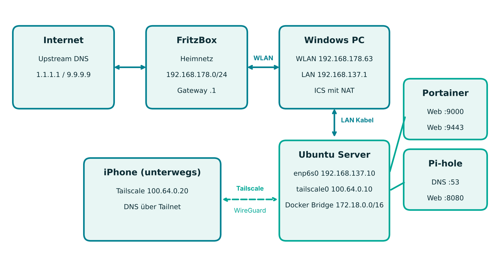
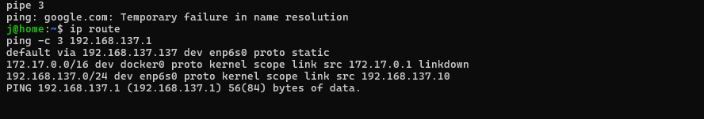
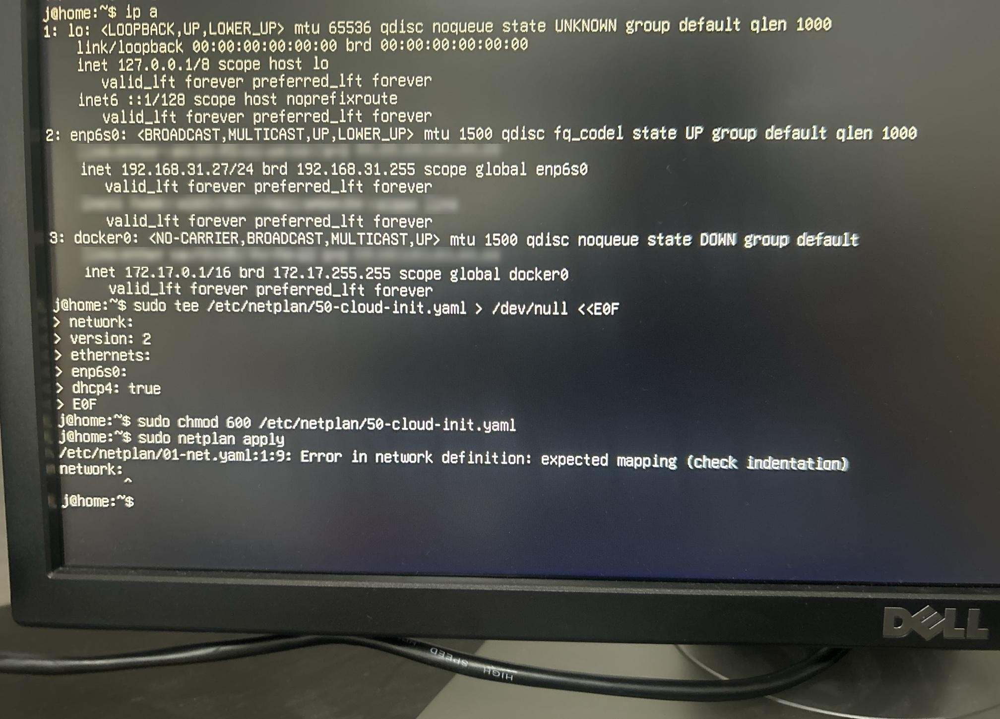
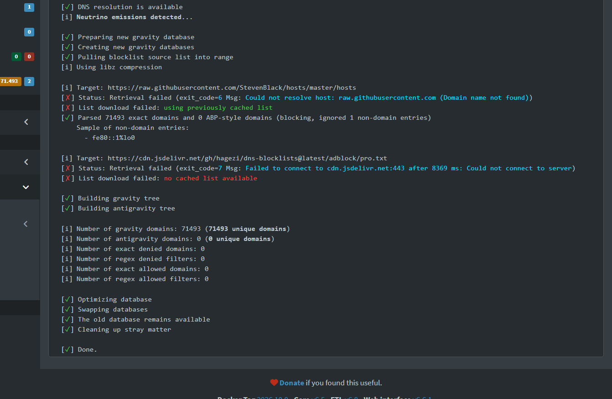
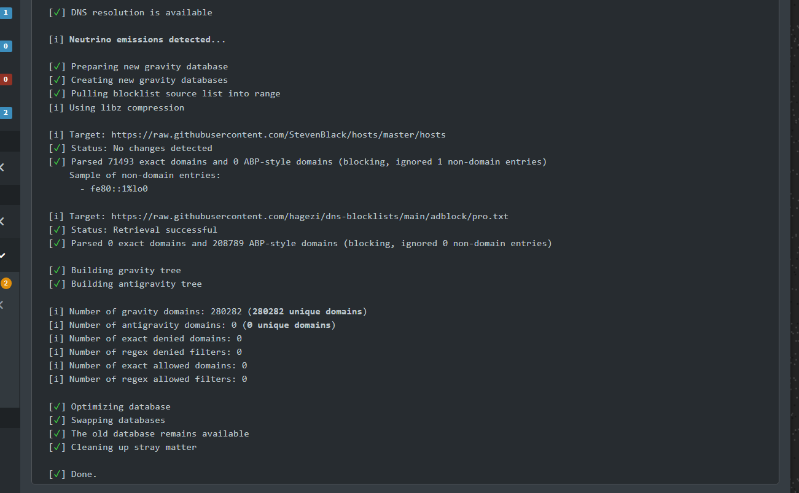
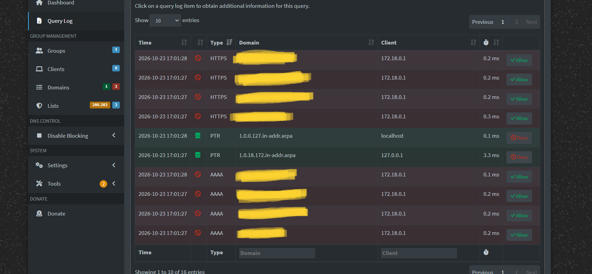

<div align="center">

# 🛡️ Homeserver mit Pi-hole und Tailscale

**Netzwerkweiter Werbeblocker auf eigener Hardware, zuhause und unterwegs nutzbar**


</div>

## Über das Projekt

Aus einem ausgemusterten PC habe ich einen Homeserver mit **Ubuntu Server**, **Docker** und **Portainer** gebaut. Darauf läuft ein **Pi-hole**, der Werbe und Tracking Domains auf DNS Ebene blockt. Über **Tailscale** (WireGuard) nutzen auch meine Handys den Filter, sogar unterwegs über mobile Daten, ohne dass ein einziger Port ins Internet offen ist.

Der Server hat weder WLAN noch eine Kabelverbindung zum Router. Deshalb hängt er per LAN direkt am Windows PC, der seine Internetverbindung über die **Windows Internetverbindungsfreigabe (ICS)** weitergibt. Dieser Aufbau hat einige echte Netzwerkprobleme verursacht, deren Analyse und Lösung den Kern dieses Projekts bilden.

| Kennzahl | Wert |
|:--|:--|
| Geblockte Domains | **280.282** (StevenBlack und Hagezi Pro) |
| Offene Ports ins Internet | **0** |
| Hardware | Alter PC, 4 Kerne, 4 GB RAM |
| Fernzugriff | Tailscale, SSH nur mit Ed25519 Schlüssel |

## Netzwerkaufbau



| Gerät oder Schnittstelle | Adresse | Rolle |
|:--|:--|:--|
| FritzBox | `192.168.178.1` | Gateway im Heimnetz |
| Windows PC, WLAN | `192.168.178.x` | Uplink ins Heimnetz |
| Windows PC, Ethernet | `192.168.137.1` | Gateway, DHCP und NAT für den Server (ICS) |
| Ubuntu Server, `enp6s0` | `192.168.137.10/24` | statisch per Netplan |
| Ubuntu Server, `tailscale0` | `100.x.x.x` | DNS Server für das Tailnet |
| Docker Bridge | `172.18.0.0/16` | internes Netz des Pi-hole Stacks |

> Tailscale Adressen, MAC Adressen und Kontonamen sind in diesem Repo anonymisiert.

## Eingesetzte Technik

| Komponente | Aufgabe |
|:--|:--|
| Ubuntu Server LTS | Betriebssystem, verwaltet per SSH |
| Netplan | IP, Gateway und DNS des Servers |
| Windows ICS | Router mit DHCP und NAT zwischen WLAN und LAN |
| Docker und Portainer CE | Container und Stacks im Browser verwalten |
| Pi-hole | DNS Server mit Blocklisten |
| Tailscale | Mesh VPN auf WireGuard Basis, funktioniert hinter CGNAT |
| OpenSSH | Fernzugriff, gehärtet mit Schlüsselauthentifizierung |

## Projektstruktur

```
homeserver-pihole-tailscale/
├── README.md
├── docker/
│   ├── pihole/
│   │   ├── docker-compose.yml
│   │   └── .env.example
│   └── portainer/
│       └── docker-compose.yml
├── config/
│   ├── netplan/50-cloud-init.yaml
│   ├── ssh/00-hardening.conf
│   └── systemd-resolved/resolved.conf.snippet
└── docs/
    ├── Homeserver_PiHole_Tailscale.pdf
    ├── Homeserver_PiHole_Tailscale.docx
    └── images/
```

## Nachbauen

**Netzwerk des Servers einrichten.** Vorlage aus `config/netplan` nach `/etc/netplan/` kopieren, Adapternamen mit `ip a` prüfen und anwenden.

```bash
sudo chmod 600 /etc/netplan/50-cloud-init.yaml
sudo netplan apply
ip route && ping -c 3 1.1.1.1
```

**Docker und Portainer installieren.**

```bash
sudo apt install docker.io docker-compose-v2
cd docker/portainer && sudo docker compose up -d
sudo docker logs portainer 2>&1 | grep -i token   # Setup Token für den ersten Login
```

**Tailscale installieren und Port 53 freigeben.**

```bash
curl -fsSL https://tailscale.com/install.sh | sh
sudo tailscale up
tailscale ip -4
# Danach DNSStubListener=no setzen, siehe config/systemd-resolved
```

**Pi-hole starten.** `.env.example` nach `.env` kopieren, Adressen und Passwort eintragen.

```bash
cd docker/pihole && cp .env.example .env && nano .env
sudo docker compose up -d
```

**Tailnet auf den Pi-hole zeigen lassen.** In der Tailscale Admin Konsole unter DNS die Tailscale Adresse des Servers als globalen Nameserver eintragen und *Override DNS servers* aktivieren.

**SSH härten.** Schlüssel unter Windows erzeugen, übertragen, testen und erst dann den Passwort Login abschalten.

```powershell
ssh-keygen -t ed25519
type $env:USERPROFILE\.ssh\id_ed25519.pub | ssh user@192.168.137.10 "mkdir -p ~/.ssh && chmod 700 ~/.ssh && cat >> ~/.ssh/authorized_keys && chmod 600 ~/.ssh/authorized_keys"
```

```bash
sudo cp config/ssh/00-hardening.conf /etc/ssh/sshd_config.d/
sudo sshd -t && sudo systemctl restart ssh
```

## Fehlersuche: Probleme und Lösungen

Die eigentliche Lernkurve. Jedes Problem wurde systematisch von unten nach oben eingegrenzt: eigene IP, Gateway, öffentliche IP, DNS.

| Symptom | Ursache | Lösung |
|:--|:--|:--|
| Server per Ping und SSH nicht erreichbar | Alte statische IP `192.168.31.27` aus der Installation, falsches Subnetz | Netplan neu konfiguriert |
| `netplan apply`: *expected mapping* | Zweite Datei `01-net.yaml` mit kaputter Einrückung | Datei entfernt, YAML neu geschrieben |
| Keine IP per DHCP | Bei der ICS war kein Zieladapter ausgewählt | *Ethernet* als Heimnetzwerkverbindung gewählt |
| *Destination Host Unreachable* | Gateway als `192.168.137.137` statt `.1` eingetragen | Mit `ip route` gefunden und korrigiert |
| Port 53 nicht bindbar | `systemd-resolved` belegt Port 53 | `DNSStubListener=no` |
| Blocklisten laden nicht | Container ohne Namensauflösung beim Start, CDN nicht erreichbar | Fallback DNS im Container, Liste direkt von GitHub |
| Alle Tailscale Clients als `172.18.0.1` | Docker übersetzt die Quelladresse (NAT) | verstanden und dokumentiert, Host Netzwerk als Option |

<details>
<summary><b>Screenshots der Fehlersuche anzeigen</b></summary>

<br>

**Falsches Gateway in der Routingtabelle**



**Netplan Fehler durch alte Konfigurationsdatei**



**Blocklisten Download vorher und nachher**




</details>

## Ergebnis



Werbe und Tracking Anfragen vom Handy werden über das Tailnet zuverlässig geblockt. Der Server ist komplett per SSH und Browser verwaltbar und von außen nicht angreifbar.

## Sicherheit

| Maßnahme | Wirkung |
|:--|:--|
| Keine Portfreigaben, Zugriff nur über Tailscale | Kein Angriffspunkt aus dem Internet, kein Missbrauch für DNS Amplification |
| Port 53 gezielt auf LAN und Tailscale Adresse gebunden | DNS nicht aus fremden Netzen erreichbar |
| Portainer und Pi-hole Weboberfläche nur an die LAN Adresse gebunden | Docker Socket nicht aus dem Tailnet erreichbar |
| SSH nur mit Ed25519 Schlüssel, Passwort und Root Login aus | Schutz gegen Brute Force |
| Device approval im Tailnet (empfohlen) | Neue Geräte brauchen manuelle Freigabe |
| Passwörter nur in `.env`, die per `.gitignore` ausgeschlossen ist | Keine Zugangsdaten im Repo |

## Was ich gelernt habe

Wie die Windows Internetverbindungsfreigabe intern als kleiner Router mit DHCP und NAT arbeitet. Wie man Netzwerkfehler mit `ip a`, `ip route` und `ping` Schicht für Schicht eingrenzt. Wie Docker Bridge Netzwerke und Portbindungen funktionieren und warum dadurch Quelladressen verloren gehen. Wie ein Mesh VPN ohne Portfreigaben durch CGNAT kommt. Und dass Einrückung in YAML Syntax ist.

## Ausblick

Server direkt ins Heimnetz bringen und Pi-hole in der FritzBox als DNS eintragen, Monitoring mit Uptime Kuma, automatische Backups der Docker Volumes, Firewall mit `ufw` und ein Reverse Proxy für sprechende Adressen.

## Ausführliche Dokumentation

Die komplette Projektdokumentation mit allen Schritten und Screenshots liegt unter [`docs/Homeserver_PiHole_Tailscale.pdf`](docs/Homeserver_PiHole_Tailscale.pdf).

---

<div align="center">

**Tscheky** · Ausbildung IT Netzwerktechnik · [GitHub @Tscheky0](https://github.com/Tscheky0)

</div>
