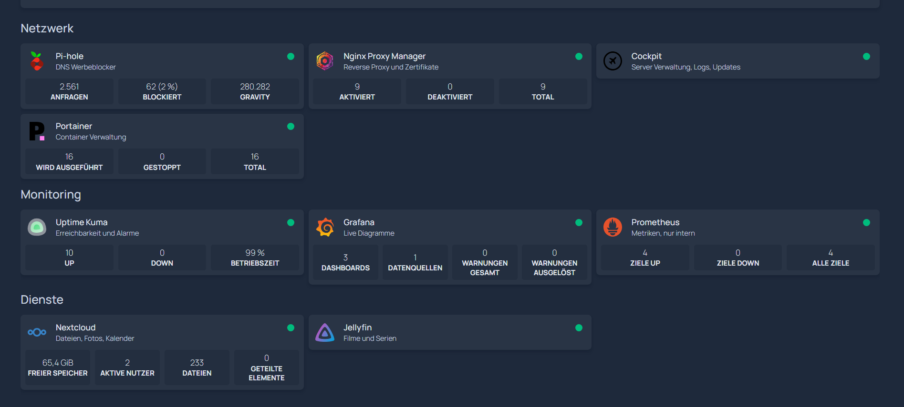
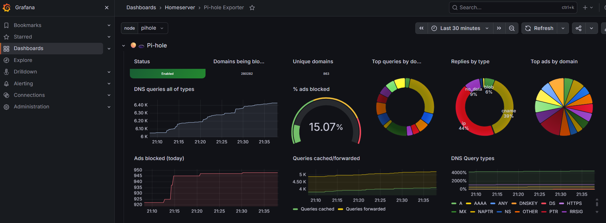
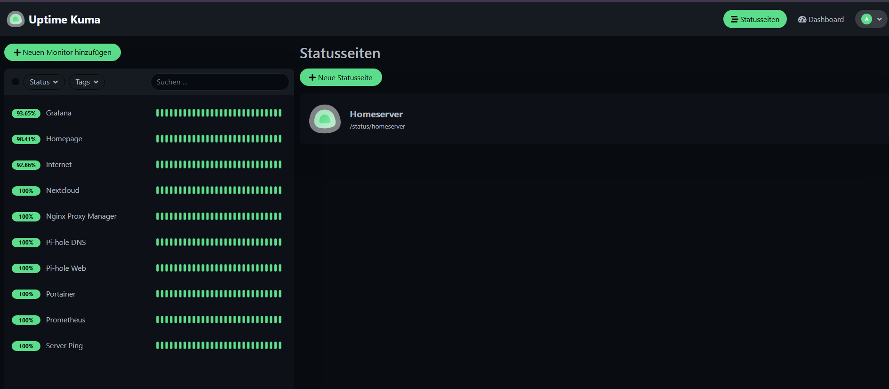
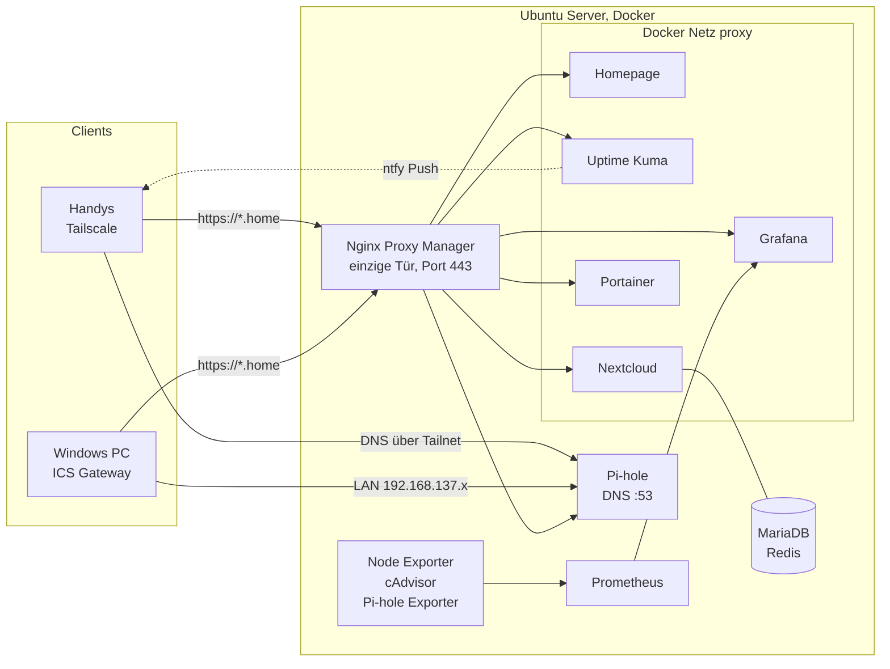

<div align="center">

# 🛡️ Homeserver mit Pi-hole, Tailscale und Monitoring

**Eigener Server aus einem alten PC: Werbeblocker, Cloud, Monitoring und Dashboard, zuhause und unterwegs nutzbar, ohne einen einzigen offenen Port ins Internet**


<br>


</div>

## Über das Projekt

Aus einem ausgemusterten PC habe ich einen Homeserver mit **Ubuntu Server** und **Docker** gebaut. Angefangen hat es mit einem **Pi-hole**, der Werbe und Tracking Domains auf DNS Ebene blockt und über **Tailscale** (WireGuard) auch auf meinen Handys unterwegs wirkt.

Im zweiten Schritt ist daraus ein kleines Rechenzentrum geworden: ein **Reverse Proxy** mit HTTPS und sprechenden Adressen wie `https://grafana.home`, **Monitoring** mit Prometheus und Grafana, **Uptime Kuma** mit Alarmen aufs Handy, eine eigene **Nextcloud** und eine **Startseite** mit Kacheln für alle Dienste.

Der Server hat weder WLAN noch eine Kabelverbindung zum Router. Er hängt per LAN direkt am Windows PC, der seine Internetverbindung über die **Windows Internetverbindungsfreigabe (ICS)** weitergibt. Dieser Aufbau hat einige echte Netzwerkprobleme verursacht, deren Analyse und Lösung den Kern dieses Projekts bilden.

| Kennzahl | Wert |
|:--|:--|
| Geblockte Domains | **280.282** (StevenBlack und Hagezi Pro) |
| Offene Ports ins Internet | **0** |
| Container | **16** in 8 Stacks |
| Überwachte Dienste | **12** Monitore und **5** Grafana Alarme, Push aufs Handy |
| Backup | Jede Nacht, Nextcloud Datenbank als SQL Dump, 3 Tage aufbewahrt |
| Hardware | Alter PC, 4 Kerne, 4 GB RAM, 500 GB HDD |
| Fernzugriff | Tailscale, SSH nur mit Ed25519 Schlüssel |

## Dienste

| Dienst | Adresse | Aufgabe |
|:--|:--|:--|
| Homepage | `https://dashboard.home` | Startseite mit Kacheln und Live Werten aller Dienste |
| Pi-hole | `https://pihole.home` | DNS Server, blockt Werbung und Tracking |
| Nginx Proxy Manager | `https://npm.home` | Reverse Proxy, HTTPS, sprechende Adressen |
| Uptime Kuma | `https://kuma.home` | Prüft jede Minute alle Dienste, meldet Ausfälle per ntfy |
| Grafana | `https://grafana.home` | Live Diagramme zu Server, Containern und Pi-hole |
| Nextcloud | `https://cloud.home` | Eigene Cloud für Dateien, Fotos und Kalender |
| Portainer | `https://portainer.home` | Container und Stacks im Browser verwalten |
| Cockpit | `https://cockpit.home` | Server Verwaltung im Browser: Logs, Firewall Meldungen, Updates, Terminal |
| Jellyfin | `https://jellyfin.home` | Eigener Streaming Dienst, gemeinfreie Filme von archive.org |

**Startseite mit Live Werten aller Dienste**



<details>
<summary><b>Grafana und Uptime Kuma anzeigen</b></summary>

<br>

**Grafana: Pi-hole Statistik live aus Prometheus**



**Uptime Kuma: zehn Monitore, Alarm per ntfy aufs Handy**



</details>

## Architektur



| Gerät oder Schnittstelle | Adresse | Rolle |
|:--|:--|:--|
| FritzBox | `192.168.178.1` | Gateway im Heimnetz |
| Windows PC, WLAN | `192.168.178.x` | Uplink ins Heimnetz |
| Windows PC, Ethernet | `192.168.137.1` | Gateway, DHCP und NAT für den Server (ICS) |
| Ubuntu Server, `enp6s0` | `192.168.137.10/24` | statisch per Netplan |
| Ubuntu Server, `tailscale0` | `100.x.x.x` | DNS Server und Proxy für das Tailnet |
| Docker Netz `proxy` | `172.x.0.0/16` | gemeinsames Netz aller Weboberflächen |

> Tailscale Adressen, MAC Adressen und Kontonamen sind in diesem Repo anonymisiert.

### So kommt eine Anfrage an

1. Das Handy fragt Pi-hole nach `grafana.home`. Eine Wildcard Regel beantwortet **jeden** Namen unter `.home` mit der Adresse des Servers.
2. Der Browser baut HTTPS zum **Nginx Proxy Manager** auf. Das Zertifikat stammt von einer eigenen Zertifizierungsstelle (mkcert), die auf den Geräten als vertrauenswürdig installiert ist.
3. NPM leitet über das interne Docker Netz `proxy` an den Container `grafana:3000` weiter. Grafana selbst hat keinen Port nach außen.

## Eingesetzte Technik

| Komponente | Aufgabe |
|:--|:--|
| Ubuntu Server LTS, Netplan | Betriebssystem, feste IP, verwaltet per SSH |
| Windows ICS | Router mit DHCP und NAT zwischen WLAN und LAN |
| Docker, Portainer CE | Jeder Dienst in einem eigenen Container, Verwaltung im Browser |
| Pi-hole v6 | DNS Server mit Blocklisten und Wildcard für `.home` |
| Tailscale | Mesh VPN auf WireGuard Basis, funktioniert hinter CGNAT |
| Nginx Proxy Manager, mkcert | Reverse Proxy mit HTTPS über eine eigene CA |
| Uptime Kuma, ntfy | Verfügbarkeit prüfen, Push Nachricht bei Ausfall |
| Nextcloud, MariaDB, Redis | Eigene Cloud mit Datenbank, Cache und Hintergrund Jobs |
| Prometheus | Sammelt alle 30 Sekunden Messwerte, speichert 15 Tage |
| Node Exporter, cAdvisor, pihole-exporter | Liefern Werte von Server, Containern und Pi-hole |
| Grafana | Dashboards, automatisch per Provisioning eingerichtet |
| Homepage, docker-socket-proxy | Startseite, sieht Docker nur lesend |
| OpenSSH | Fernzugriff, gehärtet mit Schlüsselauthentifizierung |

Alle Designentscheidungen (Netz, Ports, HTTPS, RAM Budget, Proxy Hosts, Monitore) sind mit Begründung in [`docs/ERWEITERUNG.md`](docs/ERWEITERUNG.md) festgehalten.

## Projektstruktur

```
Home-Server/
├── README.md
├── docker/
│   ├── pihole/                 DNS und Werbeblocker
│   ├── portainer/              Container Verwaltung
│   ├── proxy/                  Nginx Proxy Manager
│   ├── uptime-kuma/            Monitoring, setup-kuma.js legt alle Monitore an
│   ├── nextcloud/              App, MariaDB, Redis, Cron
│   ├── jellyfin/               Filme und Serien streamen
│   ├── monitoring/             Prometheus, Grafana, Exporter
│   │   ├── prometheus/prometheus.yml
│   │   ├── grafana/provisioning/
│   │   └── fetch-dashboards.sh
│   └── homepage/
│       └── config/             Kacheln als YAML
├── config/
│   ├── netplan/50-cloud-init.yaml
│   ├── ssh/00-hardening.conf
│   ├── sysctl/99-nonlocal-bind.conf
│   └── systemd-resolved/resolved.conf.snippet
├── scripts/
│   ├── backup.sh               nächtliches Backup aller Volumes, Configs und der CA
│   ├── firewall.sh             ufw Regeln mit Schutz gegen Aussperren
│   ├── install-cockpit.sh      Cockpit hinter NPM, ohne NetworkManager
│   ├── make-certs.sh           eigene CA und Zertifikat für *.home
│   └── archive-film.sh         gemeinfreien Film von archive.org für Jellyfin laden
└── docs/
    ├── ERWEITERUNG.md          Entscheidungen zur Erweiterung
    ├── Homeserver_Dokumentation.pdf
    └── images/
```

Jeder Stack hat eine `.env.example`. Die echte `.env` mit Passwörtern wird per `.gitignore` nie committet.

## Nachbauen

<details>
<summary><b>Teil 1: Server, Pi-hole und Tailscale</b></summary>

<br>

**Netzwerk des Servers einrichten.** Vorlage aus `config/netplan` nach `/etc/netplan/` kopieren, Adapternamen mit `ip a` prüfen und anwenden.

```bash
sudo chmod 600 /etc/netplan/50-cloud-init.yaml
sudo netplan apply
ip route && ping -c 3 1.1.1.1
```

**Docker und Portainer installieren.**

```bash
sudo apt install docker.io docker-compose-v2
sudo usermod -aG docker $USER        # danach neu anmelden
cd docker/portainer && docker compose up -d
docker logs portainer 2>&1 | grep -i token
```

**Tailscale installieren und Port 53 freigeben.**

```bash
curl -fsSL https://tailscale.com/install.sh | sh
sudo tailscale up
tailscale ip -4
# Danach DNSStubListener=no setzen, siehe config/systemd-resolved
```

**Pi-hole starten.** `.env.example` nach `.env` kopieren und Adressen eintragen. Das Passwort wird danach einmalig gesetzt und nur als Hash gespeichert, es steht in keiner Datei.

```bash
cd docker/pihole && cp .env.example .env && nano .env
docker compose up -d
docker exec -it pihole pihole setpassword
```

**Tailnet auf den Pi-hole zeigen lassen.** In der Tailscale Admin Konsole unter DNS die Tailscale Adresse des Servers als globalen Nameserver eintragen und *Override DNS servers* aktivieren.

**SSH härten.** Schlüssel unter Windows erzeugen, übertragen, testen und erst dann den Passwort Login abschalten.

```powershell
ssh-keygen -t ed25519
type $env:USERPROFILE\.ssh\id_ed25519.pub | ssh user@192.168.137.10 "mkdir -p ~/.ssh && chmod 700 ~/.ssh && cat >> ~/.ssh/authorized_keys && chmod 600 ~/.ssh/authorized_keys"
```

```bash
sudo cp config/ssh/00-hardening.conf /etc/ssh/sshd_config.d/
sudo sshd -t && sudo systemctl restart ssh
```

</details>

<details>
<summary><b>Teil 2: Reverse Proxy, Monitoring, Cloud und Dashboard</b></summary>

<br>

```bash
# Docker darf Ports an die Tailscale IP binden, auch wenn tailscale0 beim Booten noch fehlt
sudo cp config/sysctl/99-nonlocal-bind.conf /etc/sysctl.d/ && sudo sysctl --system

# Gemeinsames Netz für alle Weboberflächen
docker network create proxy
docker network connect proxy pihole && docker network connect proxy portainer

# Jeder Name unter .home zeigt auf den Server
docker exec pihole pihole-FTL --config misc.dnsmasq_lines '["address=/home/<TAILSCALE_IP>"]'

# Eigene CA und Zertifikat, danach in NPM als Custom Certificate hochladen
./scripts/make-certs.sh

# Grafana Dashboards laden, dann alle Stacks starten
docker/monitoring/fetch-dashboards.sh
for s in proxy uptime-kuma nextcloud monitoring homepage; do
  (cd docker/$s && cp -n .env.example .env && nano .env && docker compose up -d)
done

# Uptime Kuma: Admin, ntfy, 10 Monitore und Status Page in einem Schritt
docker exec -i -e KUMA_USER=admin -e KUMA_PASS=... -e NTFY_TOPIC=... \
  uptime-kuma node - < docker/uptime-kuma/setup-kuma.js
```

Proxy Hosts in NPM, Liste der Monitore und alle Details: [`docs/ERWEITERUNG.md`](docs/ERWEITERUNG.md).

</details>

## Fehlersuche: Probleme und Lösungen

Die eigentliche Lernkurve. Jedes Problem wurde systematisch von unten nach oben eingegrenzt: Link, IP, Gateway, DNS, Dienst.

**Teil 1: Grundsystem**

| Symptom | Ursache | Lösung |
|:--|:--|:--|
| Server per Ping und SSH nicht erreichbar | Alte statische IP `192.168.31.27` aus der Installation, falsches Subnetz | Netplan neu konfiguriert |
| `netplan apply`: *expected mapping* | Zweite Datei `01-net.yaml` mit kaputter Einrückung | Datei entfernt, YAML neu geschrieben |
| Keine IP per DHCP | Bei der ICS war kein Zieladapter ausgewählt | *Ethernet* als Heimnetzwerkverbindung gewählt |
| *Destination Host Unreachable* | Gateway als `192.168.137.137` statt `.1` eingetragen | Mit `ip route` gefunden und korrigiert |
| Port 53 nicht bindbar | `systemd-resolved` belegt Port 53 | `DNSStubListener=no` |
| Blocklisten laden nicht | Container ohne Namensauflösung beim Start, CDN nicht erreichbar | Fallback DNS im Container, Liste direkt von GitHub |
| Alle Tailscale Clients als `172.18.0.1` | Docker übersetzt die Quelladresse (NAT) | verstanden und dokumentiert, Host Netzwerk als Option |

**Teil 2: Erweiterung**

| Symptom | Ursache | Lösung |
|:--|:--|:--|
| NPM startet nicht auf Port 80 | CasaOS belegt `*:80` auf dem Host | NPM nur auf 443, Adressen immer mit `https://` |
| Container heißen `cadviso`, `node-exporte` | Beim Kopieren von Windows wurde `\r` zu `r`, `sed` hat jedes `r` am Zeilenende gelöscht | Dateien neu kopiert, Skripte nur noch per `scp` übertragen |
| Grafana zeigt keine Dashboards | Provisioning Ordner nach `scp` nur für den Besitzer lesbar | Ordner auf `755` gesetzt |
| Server Last 7,5, Grafana 502 | cAdvisor scannt die Plattenbelegung jedes Containers, auf der HDD minutenlang | Disk Metriken in cAdvisor abgeschaltet, Grafana mehr RAM |
| Uptime Kuma Monitor für Homepage meldet 400 | Homepage erlaubt nur bekannte Hostnamen | `homepage:3000` zu `HOMEPAGE_ALLOWED_HOSTS` |
| Pi-hole Passwort nicht auslesbar | Passwort wurde in der Oberfläche gesetzt, nur als Hash gespeichert | Eigenes **App Passwort** über die Pi-hole API erzeugt |
| PC hat plötzlich kein Internet | Tailscale am PC übernahm das DNS, war aber noch nicht freigegeben | `tailscale set --accept-dns=false`, `.home` per hosts Datei |
| PC verbindet sich nicht mehr mit der FritzBox | Altes WPA3 Profil passte nicht mehr zur geänderten WLAN Sicherheit | WLAN Profil gelöscht und neu verbunden |

<details>
<summary><b>Screenshots der Fehlersuche anzeigen</b></summary>

<br>

**Falsches Gateway in der Routingtabelle**


**Netplan Fehler durch alte Konfigurationsdatei**


**Blocklisten Download vorher und nachher**


</details>

## Ergebnis


Werbe und Tracking Anfragen vom Handy werden über das Tailnet zuverlässig geblockt. Alle Dienste sind über HTTPS mit sprechenden Namen erreichbar, werden minütlich überwacht und melden Ausfälle aufs Handy. Der Server ist komplett per SSH und Browser verwaltbar und von außen nicht angreifbar.

## Sicherheit

| Maßnahme | Wirkung |
|:--|:--|
| Keine Portfreigaben, Zugriff nur über Tailscale | Kein Angriffspunkt aus dem Internet, kein Missbrauch für DNS Amplification |
| Nur NPM öffnet einen Web Port (443), alle Dienste ohne eigenen Host Port | Eine einzige, kontrollierte Eingangstür |
| Port 53 und 443 gezielt auf LAN und Tailscale Adresse gebunden | Nicht aus fremden Netzen erreichbar |
| NPM Verwaltung (81), Portainer (9443) und Pi-hole Weboberfläche (8080) direkt nur im LAN, aus dem Tailnet nur über HTTPS und NPM | Keine unverschlüsselten Verwaltungsports |
| HTTPS mit eigener CA (mkcert) | Verschlüsselt auch im Tailnet, ohne öffentliche Domain |
| Homepage sieht Docker nur über einen Socket Proxy mit Lesezugriff | Kein Root Zugriff über das Dashboard |
| Datenbank und Redis von Nextcloud nicht im Netz `proxy` | Nur für Nextcloud selbst erreichbar |
| Pi-hole Passwort nur als Hash, eigenes App Passwort für Exporter und Dashboard | Das Admin Passwort liegt in keiner Datei |
| Portainer Version fest eingetragen | Kein versehentliches Downgrade, das die Datenbank unbrauchbar macht |
| `mem_limit` auf allen neuen Containern | Kein Dienst kann die 4 GB RAM aufbrauchen |
| SSH nur mit Ed25519 Schlüssel, Passwort und Root Login aus | Schutz gegen Brute Force |
| Device approval im Tailnet | Neue Geräte brauchen manuelle Freigabe |
| ufw (`scripts/firewall.sh`): SSH, CasaOS und Samba nur aus LAN und Tailnet, Node Exporter nur aus Docker Netzen | Dienste direkt am Host sind nicht mehr auf allen Schnittstellen offen |
| Passwörter nur in `.env`, per `.gitignore` ausgeschlossen | Keine Zugangsdaten im Repo |
| Backup jede Nacht um 3:30 (`scripts/backup.sh`), Nextcloud Datenbank als SQL Dump, 3 Tage aufbewahrt | Daten nach Fehlern oder kaputten Updates wiederherstellbar |

## Was ich gelernt habe

Wie die Windows Internetverbindungsfreigabe intern als kleiner Router mit DHCP und NAT arbeitet. Wie man Netzwerkfehler mit `ip a`, `ip route` und `ping` Schicht für Schicht eingrenzt. Wie Docker Bridge Netzwerke und Portbindungen funktionieren und warum dadurch Quelladressen verloren gehen. Wie ein Mesh VPN ohne Portfreigaben durch CGNAT kommt.

In der Erweiterung: wie ein Reverse Proxy mehrere Dienste hinter einer Adresse bündelt, wie Zertifikate und eine eigene CA zusammenspielen, wie Prometheus Metriken einsammelt und Grafana sie darstellt, und warum Monitoring auf schwacher Hardware selbst zur Last werden kann. Und dass ein VPN, das das DNS übernimmt, einem PC komplett das Internet nehmen kann.

## Ausblick

Server direkt ins Heimnetz bringen und Pi-hole in der FritzBox als DNS eintragen, Backups zusätzlich auf ein zweites Gerät kopieren und eine SSD statt der HDD.

## Ausführliche Dokumentation

| Dokument | Inhalt |
|:--|:--|
| [`docs/Homeserver_Dokumentation.pdf`](docs/Homeserver_Dokumentation.pdf) | Gesamte Projektdokumentation mit allen Schritten und Screenshots |
| [`docs/ERWEITERUNG.md`](docs/ERWEITERUNG.md) | Alle Entscheidungen der Erweiterung mit Begründung |

---

<div align="center">

**Tscheky** · Ausbildung IT Netzwerktechnik · [GitHub @Tscheky0](https://github.com/Tscheky0)

</div>
